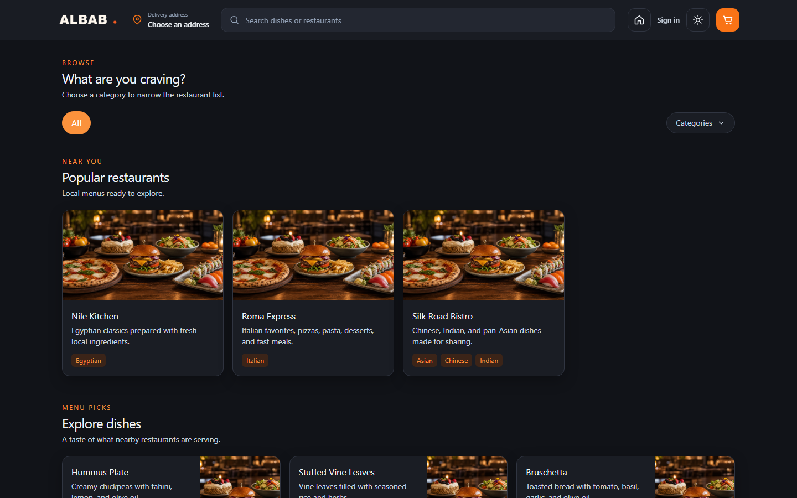
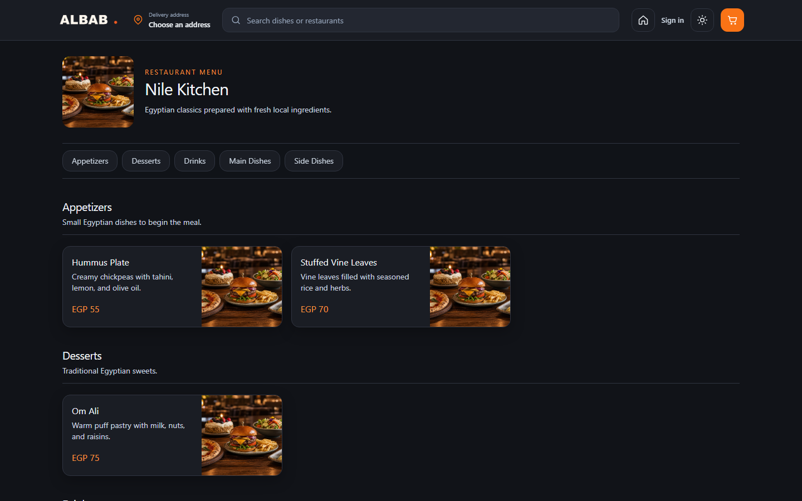
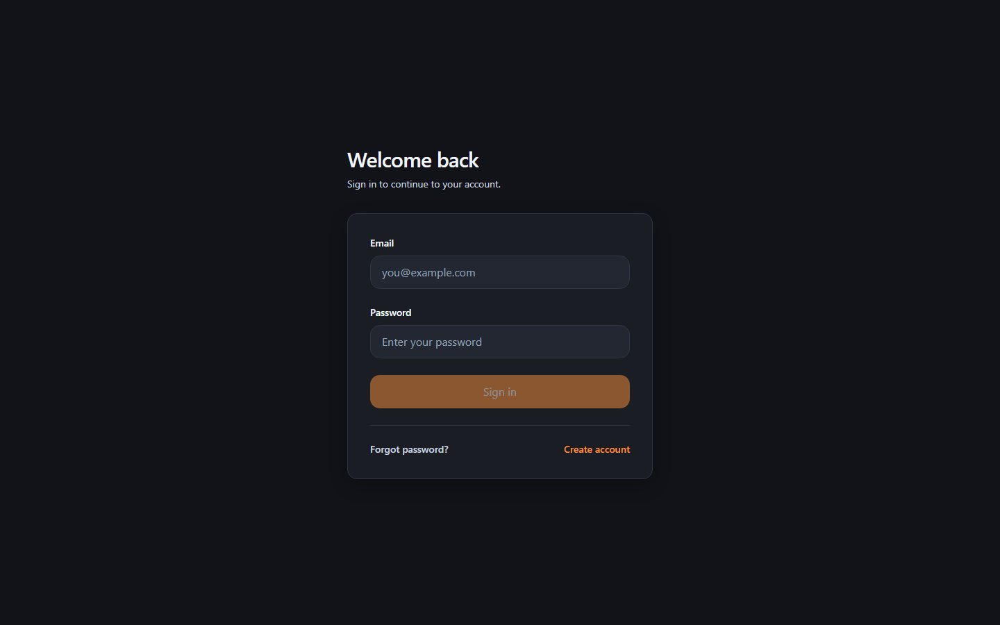

<div align="center">

# 🍔 ALBAB — Food Delivery Platform

**A full-stack, multi-role food delivery marketplace connecting customers, restaurants, delivery drivers and administrators.**


**[▶️ Watch the Demo](https://youtu.be/hex3cFJ6v4k)** · **[📖 API Docs (Swagger)](#-api-documentation)** · **[🚀 Run Locally](#-getting-started)** · **[👥 Team](#-team)**



</div>

---

## 📌 Overview

ALBAB is a production-style food ordering platform built as a team internship project. It covers the
full order lifecycle — browsing restaurants, building a cart with add-ons, checkout, kitchen
preparation, driver pickup and delivery, and post-delivery reviews — with a dedicated portal for
each of the platform's **4 user roles**.

## 📊 Project in Numbers

| Metric | Count |
| --- | ---: |
| REST API endpoints | **88** |
| REST controllers | **22** |
| User roles (Customer, Driver, Kitchen Manager, Admin) | **4** |
| Database tables | **33** |
| Flyway database migrations | **24** |
| JPA entities / domain models | **37** |
| Service implementations | **22** |
| Spring Data repositories | **22** |
| MapStruct mappers | **8** |
| Java source files (backend) | **230** |
| Angular components | **38** |
| Application pages | **19** |
| Feature modules (frontend) | **11** |
| Frontend API services | **21** |
| Client-side routes | **36** |
| Route guards | **3** |
| Layouts (customer, admin, kitchen, auth, checkout) | **5** |
| CI/CD pipelines | **2** |
| Commits | **140+** |

## ✨ Features

### 👤 Customer
- Sign up with **email OTP verification**, login, forgot / reset password
- Secure **email and password change** with verification codes
- Browse restaurants by category, view menus by section, full-text **search** across restaurants and dishes
- Cart with **menu item add-ons** (add-on groups and options)
- Multiple saved **delivery addresses** by governorate, with a default address
- Checkout, order tracking, order history and **order cancellation**
- **Restaurant reviews** and **delivery feedback**

### 🍳 Kitchen Manager (Restaurant Portal)
- Dashboard with live order stats
- Full **menu management**: items, sections, add-on groups and add-ons (16 endpoints)
- Toggle item availability, soft delete
- Accept, prepare and cancel incoming orders, with cancellation logs

### 🛵 Delivery Driver
- Driver sign-up with **admin approval workflow**
- View available orders, **accept → pick up → deliver** flow
- Active delivery and delivery history
- Driver profile

### 🛡️ Admin
- Manage restaurants, categories, customers, riders and orders
- Approve or reject driver applications
- Activate / deactivate accounts

## 🏗️ Architecture

```
┌────────────────────┐        ┌──────────────────────────┐        ┌──────────────┐
│  Angular 22 SPA    │  HTTP  │   Spring Boot 4 REST API  │  JPA   │ PostgreSQL 16│
│  (nginx in Docker) │ ─────▶ │  JWT auth · RBAC · OTP    │ ─────▶ │  + Flyway    │
│  Tailwind CSS 4    │  /api  │  Controller→Service→Repo  │        │  migrations  │
└────────────────────┘        └──────────────────────────┘        └──────────────┘
```

**Backend layers:** `controller` → `service` → `repository`, with `dto` (request / response / projection),
`mapper` (MapStruct), `security` (JWT filter), `exception` (global error handling) and `config` packages.

**Frontend structure:** `core` (auth, HTTP interceptors, models), `features` (lazy-loaded per domain),
`layouts` (one shell per role) and `shared` (reusable components and directives).

## 🛠️ Tech Stack

| Layer | Technologies |
| --- | --- |
| **Frontend** | Angular 22 (standalone components, lazy routes), TypeScript 6, Tailwind CSS 4, RxJS |
| **Backend** | Java 21, Spring Boot 4.1, Spring Security, Spring Data JPA / Hibernate, Bean Validation, MapStruct |
| **Auth & Security** | Stateless JWT, role-based access control, BCrypt, login rate limiting, CORS, email OTP |
| **Database** | PostgreSQL 16, Flyway (versioned migrations + seed data) |
| **API Docs** | SpringDoc OpenAPI / Swagger UI |
| **DevOps** | Docker, Docker Compose, nginx, GitHub Actions (CI build + tests, CD to GHCR) |

## 🔐 Security Highlights
- **JWT** access tokens with configurable expiry, validated by a custom `JwtAuthenticationFilter`
- **Role-based authorization** per route group (`/api/admin/**`, `/api/kitchen/**`, `/api/delivery/**`)
- **Brute-force protection:** failed-login rate limiting
- **OTP email verification** for sign-up, password change and email change
- All secrets come from environment variables — nothing sensitive in config files

## 🎬 Demo Video

A one-minute walkthrough of the customer flow — browse, sign in, customize a dish, cart, checkout and order placed:

<a href="https://youtu.be/hex3cFJ6v4k">
  
</a>

## 📸 Screenshots

| Restaurant menu | Sign in |
| :---: | :---: |
|  |  |

## 🚀 Getting Started

**Requirements:** [Docker Desktop](https://www.docker.com/products/docker-desktop/)

```bash
git clone https://github.com/faresmoustafa1/food-delivery-platform.git
cd food-delivery-platform
cp .env.example .env        # set OTP_ENABLED=false to skip email setup
docker compose up --build
```

| Service | URL |
| --- | --- |
| Website | http://localhost:4200 |
| REST API | http://localhost:8080 |
| Swagger UI | http://localhost:8080/swagger-ui.html |

The database schema and demo data (restaurants, menus, users) are created automatically on first start.

> Already running PostgreSQL locally? Set `DB_PORT=5433` in `.env` to avoid a port conflict.

<details>
<summary><b>Run without Docker (for development)</b></summary>

Requirements: JDK 21, Node.js 24, PostgreSQL 16.

```bash
# backend
cd backend
DB_PASSWORD=postgres OTP_ENABLED=false ./mvnw spring-boot:run

# frontend (new terminal)
cd frontend
npm install
npm start
```
</details>

## ☁️ Deployment

The repository includes a [Render Blueprint](render.yaml) that deploys the whole stack —
PostgreSQL, the Spring Boot API and the Angular site — on Render's free tier:

1. Render dashboard → **New → Blueprint** → select this repository
2. Click **Apply** — Render provisions the database, builds both apps and wires them together

The frontend proxies `/api/*` to the backend, so both are served from a single URL.

## 📖 API Documentation

Interactive docs are available at **`/swagger-ui.html`** when the backend is running.

| Area | Base path | Endpoints |
| --- | --- | ---: |
| Authentication & OTP | `/api/auth` | 11 |
| Kitchen menu management | `/api/kitchen/menu-items` | 16 |
| Delivery orders | `/api/delivery/orders` | 7 |
| Addresses | `/api/addresses` | 6 |
| Cart | `/api/cart` | 6 |
| Kitchen orders | `/api/kitchen/orders` | 5 |
| Admin — restaurants | `/api/admin/restaurants` | 5 |
| Admin — riders | `/api/admin/riders` | 5 |
| Admin — categories | `/api/admin/categories` | 4 |
| Orders | `/api/orders` | 4 |
| Reviews / delivery feedback | `/api/reviews`, `/api/delivery-feedback` | 6 |
| Restaurants, menu items, categories, search, governorates | `/api/...` | 6 |
| Profiles, dashboard, admin orders & customers | `/api/...` | 7 |
| **Total** | | **88** |

## 📁 Project Structure

```
food-delivery-platform/
├── backend/                 # Spring Boot REST API
│   └── src/main/
│       ├── java/com/talabaty/backend/
│       │   ├── controller/  # 22 REST controllers
│       │   ├── service/     # business logic
│       │   ├── repository/  # Spring Data JPA
│       │   ├── model/       # JPA entities
│       │   ├── dto/         # request / response / projection
│       │   ├── mapper/      # MapStruct
│       │   ├── security/    # JWT
│       │   └── config/      # security, CORS, OpenAPI
│       └── resources/db/migration/   # 24 Flyway migrations
├── frontend/                # Angular SPA
│   └── src/app/
│       ├── core/            # auth, interceptors, models
│       ├── features/        # customer, kitchen, driver, admin, ...
│       ├── layouts/         # one layout per role
│       └── shared/          # reusable UI
├── .github/workflows/       # CI + CD
└── docker-compose.yml
```

## 👥 Team

This project was built by a team of interns, split into frontend and backend tracks.

### 🎨 Frontend

| Name | Role | GitHub |
| --- | --- | --- |
| Ahmed Ehab | Frontend Developer | [@ahmedehabcs](https://github.com/ahmedehabcs) |

### ⚙️ Backend

| Name | Role | GitHub |
| --- | --- | --- |
| Fares Moustafa | Backend Developer | [@faresmoustafa1](https://github.com/faresmoustafa1) |
| Thuraya Khaled | Backend Developer | [@Thurayakhaled](https://github.com/Thurayakhaled) |
| Amina Ahmed | Backend Developer | [@AminaAhmed05](https://github.com/AminaAhmed05) |

### 🧭 Supervisor

| Name | Role | GitHub |
| --- | --- | --- |
| Emad Mahfouz | Project Supervisor | [@EmaddMahfouz](https://github.com/EmaddMahfouz) |

---

<div align="center">

⭐ If you like this project, give it a star!

</div>
